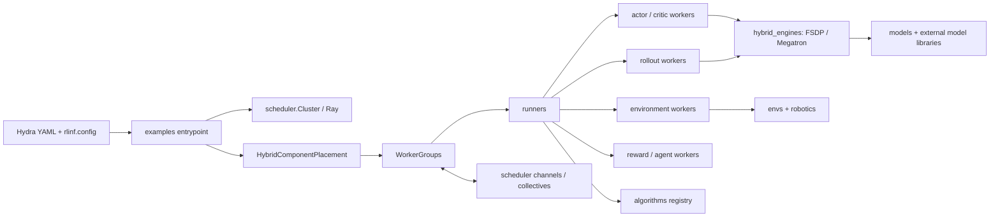
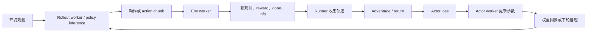

# RLinf 项目概览

本文档帮助你从项目入口进入 RLinf 的分布式强化学习代码：先识别模块边界，再运行已有示例，最后沿着 scheduler、worker、runner 和算法注册机制扩展实现。RLinf 面向 Embodied AI 与 Agentic AI，训练配置由 Hydra YAML 组合，Ray 负责跨进程与跨节点调度，模型训练由 FSDP 或 Megatron 承担，LLM rollout 可接入 Hugging Face、SGLang 或 vLLM。具体模型、环境和硬件组合以对应示例及安装文档为准。

> 💡 示例命令和配置字段根据仓库当前脚本与 YAML 编写。仿真器、模型权重、数据集和真实机器人 SDK 通常需要单独准备；相关路径以示例配置中的占位值为准。

## 第一部分：项目架构分析

### 1. 项目整体架构

#### 项目目录树

下列目录树展示主要源码、示例、依赖安装、文档和测试位置；省略了模型、环境和配置文件的具体子目录。

```text
RLinf/
├── rlinf/
│   ├── agents/             # Agentic 工作流与工具调用
│   ├── algorithms/         # advantage、loss、reward 与离线算法
│   ├── data/               # 数据集、schema、存储
│   ├── envs/               # 仿真环境、真实环境、wrappers
│   ├── hybrid_engines/     # FSDP、Megatron、SGLang、vLLM 与权重同步
│   ├── models/             # 模型构建器、Embodied policy、diffusion 模型
│   ├── robotics/           # 真实机器人、部件、动作和适配器
│   ├── runners/            # 训练、评估、SFT 与离线 RL 主循环
│   ├── scheduler/          # Cluster、Worker、placement、channel、collective
│   ├── utils/              # checkpoint、日志、分布式及训练工具
│   └── workers/            # actor、critic、rollout、env、reward、agent、SFT
├── examples/
│   ├── agent/ reasoning/    # Agentic 与推理任务入口及配置
│   ├── embodiment/         # 具身训练入口、环境与模型配置
│   ├── offline_rl/ reward/ # 离线 RL 与 reward 工作流
│   └── sft/                # VLA/VLM SFT 入口及配置
├── evaluations/            # 独立具身评估脚本和配置
├── requirements/           # 安装脚本及各目标依赖
├── ray_utils/              # Ray 启动及多机辅助脚本
├── toolkits/               # 数据、回放、自动 placement 等工具
├── tests/
│   ├── unit_tests/         # 组件级测试
│   ├── e2e_tests/          # 端到端训练与评估
│   ├── parity_tests/       # 配置/实现一致性检查
│   └── robot_mocks/        # 真实机器人 SDK 的 mock
└── docs/
    ├── source-en/ source-zh/ # Sphinx 英文与中文文档
    └── OVERVIEW.md          # 本项目概览
```

#### 核心模块与依赖关系

入口脚本组合配置并创建资源，runner 组织任务循环，worker 执行具体计算。scheduler 把 worker 放置到 Ray 节点和设备上，并通过 channel/collective 提供进程间数据交换。



| 模块 | 职责与技术栈 | 主要依赖/接口 |
|---|---|---|
| `scheduler/` | Ray 上的集群、节点、Worker/WorkerGroup 生命周期、placement、channel 和 collective；Python、Ray、PyTorch distributed | `Cluster`、`Worker`、WorkerGroup 的 `create_group(...).launch(...)` 工作流 |
| `workers/` | 按职责封装 actor、critic、rollout、env、reward、agent 和 SFT 计算 | scheduler Worker API；模型、环境、训练引擎 |
| `runners/` | 编排初始化、训练/评估循环、checkpoint 与指标 | worker groups、算法接口、配置 |
| `algorithms/` | advantage、policy loss、reward 及离线算法实现和 registry | PyTorch；`register_advantage`、`register_policy_loss` 等 |
| `models/` | 将配置映射到模型构造器；包含具身 policy 与 diffusion 模型 | PyTorch、Transformers 及模型专属依赖；`register_model` |
| `envs/`、`robotics/` | 仿真/真实环境、动作处理、机器人硬件接口 | Gym 生态、仿真器、厂商 SDK；`get_env_cls()` 与 robot API |
| `hybrid_engines/` | 训练 backend、推理 backend 和训练/推理权重同步 | FSDP、Megatron、SGLang、vLLM |
| `data/`、`utils/` | 数据 schema/storage，以及日志、checkpoint、通信、压缩和性能工具 | PyTorch、NumPy、Ray 与可选依赖 |
| `examples/` | 可执行的 Hydra 入口与任务配置 | `requirements/install.sh` 针对任务的环境依赖 |

#### 一次具身训练的数据流

同步具身 PPO/GRPO 的常见路径是 rollout worker 请求 policy 生成动作，env worker 推进环境并返回观测与奖励，runner 组装轨迹并驱动 advantage 计算和 actor 更新。异步 runner 会调整采样与更新的重叠方式，具体语义以对应 runner 实现和配置为准。



**本节检查清单**

- [ ] 能区分入口、runner、worker 与 scheduler 的职责。
- [ ] 能沿着配置、placement、rollout、环境反馈和参数更新描述训练数据流。
- [ ] 能从目录树定位目标示例和实现模块。

### 2. 模块详细说明

#### 配置到运行时对象

Hydra 配置通过 `validate_cfg()` 做统一校验；入口脚本随后创建 `Cluster` 与 `HybridComponentPlacement`，然后根据 task 和 loss/backend 选择 worker 类。WorkerGroup 由 worker 类的 `create_group(cfg)` 构造，再通过 `launch(cluster, name=..., placement_strategy=...)` 启动。runner 接收这些 group，调用 `init_workers()` 和 `run()`。

具身入口可读 [examples/embodiment/train_embodied_agent.py](../examples/embodiment/train_embodied_agent.py)；异步入口是 [examples/embodiment/train_async.py](../examples/embodiment/train_async.py)；VLA SFT 入口是 [examples/sft/train_vla_sft.py](../examples/sft/train_vla_sft.py)。这些脚本提供了 actor、rollout、env、reward 与 runner 的实际装配范例。

#### 关键类、函数和调用约定

| 符号 | 所在位置 | 作用 |
|---|---|---|
| `Cluster` | `rlinf/scheduler/cluster/` | 表示运行集群并承载 worker group 启动与资源管理。 |
| `Worker` / WorkerGroup | `rlinf/scheduler/worker/`、scheduler 包 | 为本地或 Ray worker 提供统一生命周期与远程调用抽象。 |
| `HybridComponentPlacement` | `rlinf/utils/placement.py` | 根据配置计算 actor、rollout、env 等组件的资源分配策略。 |
| `validate_cfg` | `rlinf/config.py` | 校验并规范化配置，检查任务、模型、backend 等约束。 |
| `EmbodiedRunner`、`AsyncEmbodiedRunner` | `rlinf/runners/` | 同步/异步具身训练控制流。 |
| `SFTRunner` | `rlinf/runners/sft_runner.py` | SFT 训练循环。 |
| `register_model` | `rlinf/models/__init__.py` | 注册模型构造函数，使配置中的 `model_type` 能解析到 builder。 |
| `register_advantage`、`register_policy_loss` | `rlinf/algorithms/registry.py` | 注册可由算法配置选择的 advantage 与 loss 函数。 |
| `get_env_cls` | `rlinf/envs/__init__.py` | 依据 `env_type` 延迟导入环境实现。 |

自定义组件需要在 worker 所在进程可见。仓库说明，driver 进程中的注册不会自动传播到 Ray worker；外部扩展可通过 `RLINF_EXT_MODULE` 加载模块，详见英文扩展指南 `docs/source-en/rst_source/extending/`。

#### 配置文件与常用字段

配置通常按 Hydra defaults 组合，例如 `examples/embodiment/config/libero_spatial_grpo_openpi_pi05.yaml` 引入 env、model、FSDP 和权重同步子配置。顶层配置承载实验参数，子配置放在 `env/`、`model/`、`hybrid_engines/` 等目录。

| 配置段 | 常见字段 | 含义 |
|---|---|---|
| `cluster` | `num_nodes`、`component_placement` | Ray 集群节点数以及 worker 组件的设备放置。 |
| `runner` | `task_type`、`max_epochs`、`max_steps`、`save_interval`、`resume_dir`、`logger` | 任务循环、训练长度、保存/恢复和日志。具体优先级或特殊值以 runner 为准。 |
| `algorithm` | `adv_type`、`loss_type`、`group_size`、`kl_beta`、`gamma`、`gae_lambda` | 算法分派和算法超参数；字段依算法而不同。 |
| `env.train` / `env.eval` | `env_type`、`total_num_envs`、`rollout_epoch`、`max_episode_steps` | 训练/评估环境类型与采样规模。 |
| `actor` | `training_backend`、`micro_batch_size`、`global_batch_size`、`model`、`optim` | policy 更新 backend、batch、模型和优化器。 |
| `rollout` | `generation_backend`、`model.model_path`、`pipeline_stage_num` | 推理 backend、权重来源和 rollout pipeline。 |
| `reward` / `critic` | `use_reward_model`、模型/API 配置 | 是否启用独立 reward 或 critic 组件。 |

配置中的字段不是对所有任务通用的 schema。修改前应检查相同任务族的现有配置、对应入口如何读取字段，以及 `validate_cfg()` 的约束；不应把某个示例的参数直接套用到其他 runner。

**本节检查清单**

- [ ] 能追踪 `validate_cfg` → `Cluster` → WorkerGroup → runner 的启动顺序。
- [ ] 能找到当前实验配置导入的 defaults 子配置。
- [ ] 修改参数前已对照实际 runner 和 worker 的配置读取代码。

### 3. 代码组织逻辑

RLinf 以职责划分包，以 Hydra 配置组合实验。模型、算法、环境分别有 registry 或 factory，避免把每种模型/环境的专用依赖硬编码进统一入口；环境实现通常按 `sim/<name>/` 或 `real/` 组织，模型实现集中在 `models/`，任务控制逻辑放在 runner。

主要设计方式包括：

- **Registry 与 factory：** 模型 builder、advantage、policy loss、reward、环境类通过注册或工厂解析配置。
- **WorkerGroup 抽象：** 入口以组件 group 为单位启动 worker；runner 调用稳定的 worker 接口而非直接管理每个 Ray actor。
- **配置组合：** YAML defaults 将任务、模型、环境和 engine 配置拼装；Hydra CLI override 可在运行时覆盖字段。
- **后端适配：** `hybrid_engines/` 连接训练与推理 backend，weight syncer 传递或重整参数。
- **延迟导入：** 仿真器、机器人 SDK 和模型专属包并非所有环境都有，部分实现按分支导入以支持可选依赖。

控制流从入口进入 runner，由 runner 推进迭代并在各阶段调用 worker group；数据流通过返回值、channel 和 collective 在 worker 间传递。排查问题时先确定数据由谁产生、在哪个 worker 进程消费，再检查同步边界和配置 placement。

**本节检查清单**

- [ ] 能识别 registry、factory、worker 抽象和 Hydra 组合配置的使用场景。
- [ ] 能分别追踪训练控制流和 worker 间的数据流。

## 第二部分：快速上手指南

### 1. 环境准备

RLinf 要求 Python `>=3.10`；安装脚本默认创建 Python `3.11.14` 环境。实际运行还需要与所选模型、仿真器、GPU 驱动和 CUDA/ROCm 等设备栈兼容。最可靠的起点是仓库安装脚本，它按 `embodied`、`agentic`、`docs` 目标和硬件平台处理依赖。

先按目标安装。以下命令为 NVIDIA 上的示例，模型和环境名须与 `requirements/install.sh` 支持的值一致：

```bash
# 在仓库根目录运行；以一个具身模型和 LIBERO 环境准备默认 .venv。
bash requirements/install.sh embodied --model openpi --env libero
source .venv/bin/activate
```

安装脚本支持的主要目标与选项如下：

| 项目 | 可选值/默认值 | 说明 |
|---|---|---|
| target | `embodied`、`agentic`、`docs` | 选择具身、Agentic 或文档依赖集。 |
| `--venv` | 默认 `.venv` | 指定虚拟环境路径。 |
| `--model`、`--env` | 由脚本 `SUPPORTED_MODELS`、`SUPPORTED_ENVS` 定义 | 对具身目标选择安装组合；完整当前列表见脚本帮助。 |
| `--engine` | `sglang` 或 `vllm` | Agentic 推理引擎；两者版本约束不同，脚本建议使用独立 venv。 |
| `--platform` | `nvidia`（默认）、`amd`、`ascend`、`musa`、`kunlun`、`biren`、`metax` | 选择 accelerator 依赖路径；除 NVIDIA 外多个平台仍标注为 experimental。 |
| `--python` | 默认 `3.11.14` | 指定 Python 版本，最低 `3.10`；特定环境可能要求或覆盖版本。 |
| `--no-flash-attn` | 开关 | 跳过 flash-attn 安装。 |

更多选项可运行 `bash requirements/install.sh --help` 查看。安装脚本可能安装系统依赖；非 root 用户使用 `--no-root` 前需确认系统依赖已具备。仿真资产、模型权重、真实机器人 SDK 等外部资源仍需按具体示例准备。

常见问题：

- **找不到仿真器或 SDK：** 确认该 env 的安装步骤已执行、环境变量/外部仓库路径已配置，并检查 `get_env_cls()` 对应实现的依赖。
- **模型路径不存在：** 把示例 YAML 中 `/path/to/...` 替换为实际 checkpoint 路径；涉及 Hugging Face 下载时按模型页面和环境要求准备缓存。
- **设备或 kernel 不兼容：** 检查安装时的 `--platform`、torch 版本和驱动是否匹配；可先按脚本提供的 `--no-flash-attn` 选项缩小安装问题范围。
- **Ray 多机未识别设备环境变量：** 每个节点应在启动 Ray 前设置唯一 `RLINF_NODE_RANK`；可选设置 `RLINF_COMM_NET_DEVICES`。Ray 会在启动时捕获环境变量。

**本节检查清单**

- [ ] Python 和设备栈满足所选模型、环境的要求。
- [ ] 安装目标和 `--model`、`--env`、`--platform` 相符。
- [ ] 已准备 YAML 引用的权重、数据集和外部仿真/机器人资源。

### 2. 项目启动流程

启动一个 embodied 配置时，仓库推荐通过 `examples/embodiment/run_embodiment.sh` 设置 `EMBODIED_PATH`、`PYTHONPATH`、渲染环境变量和日志目录，再调用 `train_embodied_agent.py`。例如运行 LIBERO spatial 上的 π₀.₅ GRPO 配置：

```bash
# 在仓库根目录，先激活已安装好模型与环境依赖的 venv。
source .venv/bin/activate
bash examples/embodiment/run_embodiment.sh libero_spatial_grpo_openpi_pi05
```

该脚本将配置名传给 Hydra，并把日志写入 `logs/<时间>-<配置名>/`。配置将 `actor.model.model_path` 和 `rollout.model.model_path` 指向真实模型目录；运行前请编辑 [该 YAML 配置](../examples/embodiment/config/libero_spatial_grpo_openpi_pi05.yaml) 中的占位路径，并确认 LIBERO 数据/资产已安装。

Hydra override 可直接追加在 Python 入口参数中。若使用仓库 shell launcher，脚本会将 `STEPS`、`SAVE_INTER` 和 `NODES` 环境变量转换成对应 override：

```bash
# 最多执行 100 步，使用每 20 步保存一次的设置，并申请 2 个 Ray 节点。
STEPS=100 SAVE_INTER=20 NODES=2 \
  bash examples/embodiment/run_embodiment.sh libero_spatial_grpo_openpi_pi05
```

`STEPS` 映射到 `runner.max_steps`，`SAVE_INTER` 映射到 `runner.save_interval`，`NODES` 映射到 `cluster.num_nodes`。多机运行前需先按 `ray_utils/start_ray.sh` 和 `ray_utils/` 指南启动集群；入口脚本只在 head 节点执行。

常见启动入口：

| 场景 | 入口/示例 | 说明 |
|---|---|---|
| 同步具身 RL | `examples/embodiment/run_embodiment.sh <config>` | 默认配置为 `maniskill_ppo_openvlaoft`；配置名不带 `.yaml`。 |
| 异步具身 RL | `examples/embodiment/run_async.sh <config>` | 默认配置为 `maniskill_sac_mlp_async`。 |
| VLA SFT | `examples/sft/run_vla_sft.sh <config>` | 该 launcher 还引用 `LIBERO_REPO_PATH`、`DREAMZERO_PATH` 等路径，按所选任务准备。 |
| Reasoning GRPO | `python examples/reasoning/main_grpo.py --help` | Hydra 入口；具体配置通过其 `config/` 下文件和 README 任务说明选择。 |
| 独立评估 | `bash evaluations/run_eval.sh <benchmark> <config>` | 读取 `evaluations/` 对应基准配置；先核实脚本支持的 benchmark 名称。 |

以下是原生 Hydra 启动形式，适用于要直接追加任意配置 override 的情况：

```bash
# 在仓库根目录执行；用配置文件中的真实模型与环境路径替换占位值。
export EMBODIED_PATH="$PWD/examples/embodiment"
python examples/embodiment/train_embodied_agent.py \
  --config-path "$EMBODIED_PATH/config" \
  --config-name libero_spatial_grpo_openpi_pi05 \
  runner.max_steps=100 \
  actor.model.model_path=/models/my-policy \
  rollout.model.model_path=/models/my-policy
```

**本节检查清单**

- [ ] 入口、config name 和目标任务相符。
- [ ] 权重、数据和仿真资产路径有效。
- [ ] 多机运行已先启动 Ray，并在各节点设置 node rank。

### 3. 训练参数配置

训练参数分散在 `runner`、`algorithm`、`env`、`actor`、`rollout` 等配置段。以下以 [libero_spatial_grpo_openpi_pi05.yaml](../examples/embodiment/config/libero_spatial_grpo_openpi_pi05.yaml) 为例列出有代表性的字段；默认值仅表示该示例 YAML 的值，不是所有任务的通用默认值。

| 参数 | 示例值 | 作用与调节方向 |
|---|---:|---|
| `cluster.num_nodes` | `1` | 集群节点数。必须与可用 Ray 节点一致。 |
| `runner.max_epochs` | `1000` | epoch 上限；是否同时受 `max_steps` 限制由 runner 控制。 |
| `runner.max_steps` | `-1` | 示例中表示不按 step 限制；优先确认所用 runner 的特殊值语义。 |
| `runner.save_interval` | `40` | checkpoint 保存间隔，计数单位按对应 runner 实现。 |
| `algorithm.group_size` | `8` | GRPO 每组采样规模；增大可能提升组内比较信息，也会增加 rollout 与显存开销。 |
| `algorithm.adv_type` | `grpo` | advantage 计算注册名。 |
| `algorithm.loss_type` | `actor` | policy loss 类型，入口据此选择 actor worker 路径。 |
| `algorithm.kl_beta` | `0.0` | KL 项权重。调整时需结合目标稳定性和算法实现。 |
| `env.train.total_num_envs` | `64` | 并行训练环境数；受显存、仿真吞吐和 worker placement 限制。 |
| `env.train.max_episode_steps` | `240` | 单 episode 截断步数。 |
| `actor.micro_batch_size` | `128` | 每次设备计算的 micro batch；影响显存占用。 |
| `actor.global_batch_size` | `2048` | 更新使用的全局 batch；需和 worker 数及 micro batch 配合。 |
| `actor.optim.lr` | `5e-6` | actor 学习率。建议先沿用模型配套配置，再做小幅调整。 |
| `rollout.generation_backend` | `huggingface` | 本例推理 backend。可选 backend 取决于模型/worker 支持，不应仅凭全局列表替换。 |
| `actor.model.num_action_chunks` | `5` | policy action chunk 与环境执行接口相关；需和 env action horizon 对齐。 |

此示例没有给这些字段定义统一取值范围。`max_steps`、`max_epochs` 等字段的负数含义也可能由 runner 单独约定。调优时先固定模型、环境和算法，逐项调整并监控 reward、成功率、吞吐、显存与梯度指标；batch 和并行环境数变化会改变采样/更新负载，不能只按单卡配置推断。

**本节检查清单**

- [ ] 参数默认值已注明来源配置，而非误当作全局默认值。
- [ ] 参数含义已与当前任务的 runner/worker 校验逻辑核对。
- [ ] 调优时同时观察任务指标、吞吐和资源占用。

## 第三部分：深入学习路线

### 1. 代码阅读顺序

按一次运行的调用顺序阅读，能把配置字段、分布式对象和训练循环连接起来。推荐路径如下：

| 阶段 | 必读文件/目录 | 学习目标 |
|---|---|---|
| 1. 选择一个工作流 | 一个入口，例如 `examples/embodiment/train_embodied_agent.py`，及其 YAML | 看懂 Hydra 如何载入配置、入口如何选择 worker、参数怎样传入 runner。 |
| 2. 配置校验与 placement | `rlinf/config.py`、`rlinf/utils/placement.py`、`rlinf/scheduler/cluster/` | 理解配置约束、资源策略和 `Cluster` 生命周期。 |
| 3. worker 生命周期 | `rlinf/scheduler/worker/`、`rlinf/workers/actor/`、`rollout/`、`env/` | 理解 worker group 启动、远程调用以及 worker 间数据交接。 |
| 4. 控制循环 | 对应 `rlinf/runners/` runner | 找到 rollout、轨迹收集、advantage、update、保存与评估的顺序。 |
| 5. 算法和模型 | `rlinf/algorithms/`、`rlinf/models/`、`rlinf/hybrid_engines/` | 追踪注册名如何映射到 loss/模型实现，以及 backend 如何执行。 |
| 6. 环境边界 | `rlinf/envs/`、`rlinf/robotics/`、相应 unit/e2e tests | 理解 observation/action schema、环境封装和设备交互。 |

Agentic 任务从 `examples/reasoning/`、`examples/agent/` 和相应 `rlinf/agents/`、reasoning runner 开始；SFT 从 `examples/sft/`、`rlinf/runners/sft_runner.py` 和 `rlinf/workers/sft/` 开始；offline RL 从 `examples/offline_rl/`、offline runner 和 `rlinf/algorithms/offline/` 开始。具体任务可能拥有独立调用链，不应把具身路径视为所有任务的唯一路径。

**本节检查清单**

- [ ] 已从一个实际入口和实际配置开始阅读。
- [ ] 已沿调用链读到 runner，而不是只浏览目录名。
- [ ] 已按任务类型切换到对应 runner、worker 和算法实现。

### 2. 核心概念理解

- **Cluster：** scheduler 管理的计算集群视图，承载节点与 worker group 的部署。
- **Worker / WorkerGroup：** Worker 是有明确职责的运行单元；WorkerGroup 将一组 worker 作为组件启动和调用。
- **Placement：** 把组件映射到节点、设备和进程的资源布局，配置入口通常在 `cluster.component_placement`，策略实现位于 scheduler 和 placement 工具中。
- **Runner：** 任务级控制器，编排 worker 的调用顺序、迭代、验证、checkpoint 和指标记录。
- **Rollout：** policy 与环境交互并收集轨迹的过程；具身任务的动作可以按 action chunk 发出。
- **Advantage / policy loss：** 算法将 reward、轨迹和 baseline 信息转换成更新信号，再由 loss 函数计算优化目标。
- **Hybrid engine：** 将训练 backend、推理 backend 及其权重同步组合起来，使采样和更新可使用各自适合的执行方式。
- **Hydra 配置组合：** defaults 把实验、模型、环境和引擎 YAML 合并；CLI override 可覆盖字段，但配置必须符合目标组件的 schema 和约束。

要理解系统设计背景，可从仓库 README 中的论文链接及 `docs/source-en/rst_source/concepts/` 开始；执行流程文档位于 `concepts/execution_flow.rst`，算法说明位于 `reference/algorithms/`，安装和运行指南位于 `start/`、`guides/`。本仓库会持续演进，阅读时以当前源码和配置为准。

**本节检查清单**

- [ ] 能解释 Cluster、placement、worker 和 runner 之间的关系。
- [ ] 能描述 rollout 数据如何变成算法更新。
- [ ] 已找到与目标工作流对应的概念和算法资料。

### 3. 二次开发指南

新增能力优先沿用现有 registry 或组件边界，并选择最相近的实现作为模板。仓库根目录 [AGENTS.md](../AGENTS.md) 记录了贡献约定、测试组织和注册表位置；扩展工作流可查阅 `docs/source-en/rst_source/extending/` 对应专题。

#### 可扩展点与贡献流程

| 扩展对象 | 主要位置/API | 配置选择方式 |
|---|---|---|
| Advantage / policy loss | `rlinf/algorithms/registry.py` 的 `@register_advantage(name)`、`@register_policy_loss(name)` | `algorithm.adv_type`、`algorithm.loss_type` |
| Rule-based reward | `rlinf/algorithms/rewards/` 的 reward registry | `reward.reward_type` |
| Model | `rlinf/models/__init__.py` 的 `register_model(model_type, builder, category=...)` | 模型配置的 `model_type` |
| Simulator env | `rlinf/envs/sim/<name>/`、`SupportedEnvType`、`get_env_cls()`、动作适配 | `env.train.env_type` / `env.eval.env_type` |
| Robot / real-world task | `rlinf/robotics/`、`rlinf/envs/real/` | `env_type: real` 与机器人/任务配置 |
| Task family | `rlinf/runners/` 与 `examples/` 新入口 | 由入口脚本启动 |

开发时从现有组件复制最小可行配置，保持可选依赖按需导入，并在 worker 进程中注册外部模块。按改动边界补充 `tests/unit_tests/` 或 `tests/e2e_tests/`；仿真和真实硬件依赖可使用仓库已有 mocks，但测试应验证调用者可见的 contract。代码遵守 Ruff 格式、Python 文件版权头、签署 DCO 的提交约定；提交前按项目 CI 说明运行适用检查。

#### 二开示例

**示例一：注册 advantage。** 在 `rlinf/algorithms/advantages.py` 或相应算法模块定义函数，并使用 registry decorator 注册名称；确保模块在使用前导入，再在目标配置中填写对应的 `algorithm.adv_type`。函数的输入/输出应遵守相邻 advantage 实现使用的张量形状与返回约定。

```python
from rlinf.algorithms.registry import register_advantage


@register_advantage("my_advantage")
def calculate_my_advantage(**kwargs):
    # 根据现有实现约定读取轨迹张量并返回 advantages 与 returns。
    advantages = ...
    returns = ...
    return advantages, returns
```

上面 `...` 代表需要按实际算法补全的计算，不能直接运行；开发时应复制现有函数的签名契约、mask 处理和 shape 约定，并添加针对输出的单元测试。

**示例二：注册模型 builder。** 实现模型构造函数后，在启动进程会导入的扩展模块中注册它，再让模型配置的 `model_type` 指向注册名。模型 registry 接收 `DictConfig` 和可选 dtype，并由 builder 返回模型对象；完整 worker 集成还需符合对应 actor/rollout 的模型接口。

```python
from rlinf.models import register_model


def build_my_policy(cfg, torch_dtype=None):
    # 返回符合目标 worker 接口的模型实例。
    return MyPolicy(cfg, torch_dtype=torch_dtype)


register_model("my_policy", build_my_policy, category="embodied")
```

将扩展模块路径设置到 `RLINF_EXT_MODULE`，使每个相关 worker 进程都执行注册；driver 单独注册不足以更新 Ray worker 的进程内 registry。具体扩展模块加载方式可参照 `extending/new_model_fsdp.rst`。

**示例三：添加仿真环境。** 在 `rlinf/envs/sim/<name>/` 实现环境类，在 `SupportedEnvType` 加入稳定的配置值，并在 `get_env_cls()` 加入延迟导入分支；同时实现或复用 `prepare_actions()` 所需的动作格式转换。配置 `env_type` 后，通过环境单测、mock/e2e 配置和真实仿真环境验证 observation、action、reward、termination 的 contract。具体环境实现细节依模拟器而异，以下为开发步骤而非可直接执行的代码。

调试时建议按边界逐层检查：先打印/记录解析后的配置，再确认 Cluster 节点和 placement，再单独验证 worker 初始化，最后定位 rollout 张量、环境返回值或 loss 指标。Worker 内使用 `self.log_info`、`self.log_warning`、`self.log_error`；非 Worker 代码使用 `rlinf.utils.logging.get_logger()`。涉及 Ray 时检查 worker 端日志和进程内注册情况；涉及真实设备时使用对应的 mock SDK 或小规模环境配置复现。

**本节检查清单**

- [ ] 选用与功能类型匹配的 registry/factory 扩展入口。
- [ ] 确保注册代码在每个 Ray worker 进程可见。
- [ ] 新组件遵守现有输入/输出、shape、生命周期和配置约定。
- [ ] 添加覆盖用户可见 contract 的 unit 或 e2e 用例，并按贡献指南检查。

## 附录：进一步阅读

- 安装脚本：[`requirements/install.sh`](../requirements/install.sh)
- 仓库贡献和工程约定：[`AGENTS.md`](../AGENTS.md)、[`CONTRIBUTING.md`](../CONTRIBUTING.md)
- 英文/中文使用文档：[`docs/source-en/`](source-en/index.rst)、[`docs/source-zh/`](source-zh/index.rst)
- 端到端测试与组件测试：[`tests/`](../tests/)
